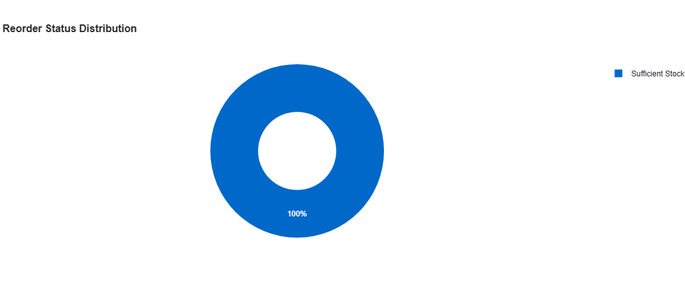
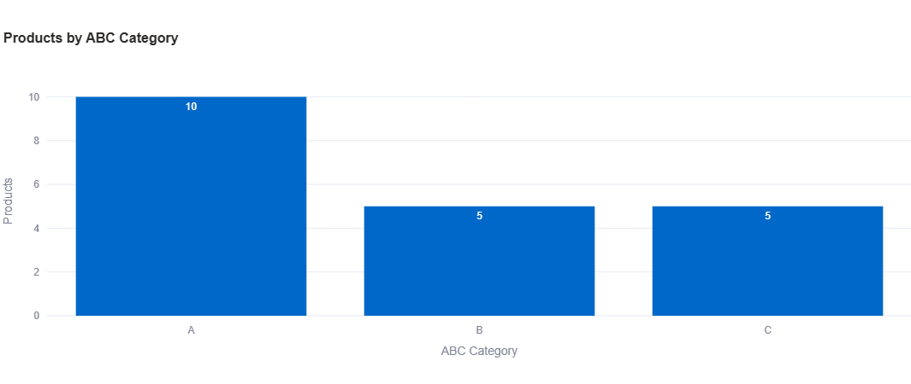
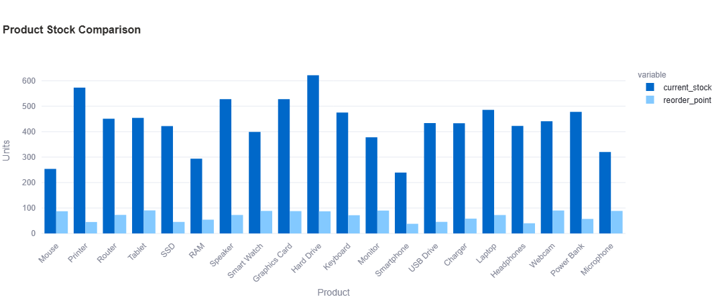
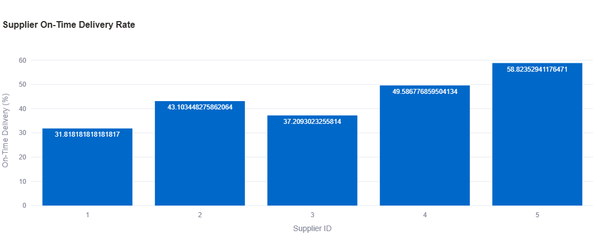

# Supply Chain & Inventory Optimization Dashboard

A Python-based data analytics project that analyzes inventory performance, supplier reliability, demand patterns, and replenishment requirements through an interactive Streamlit dashboard.

## Project Overview

This project demonstrates how data analytics can support supply chain and inventory management decisions.

Using simulated product, sales, inventory, and supplier datasets, the project identifies inventory risks, evaluates supplier delivery performance, classifies products by inventory value, and generates replenishment recommendations.

## Dashboard Screenshots

### 1. Inventory Reorder Status


### 2. ABC Inventory Classification


### 3. Product Stock Comparison


### 4. Supplier Performance


### 5. Replenishment Recommendations


## Key Features

- Data cleaning and exploratory data analysis
- Inventory KPI analysis
- Inventory valuation and stock monitoring
- ABC inventory classification
- Daily demand variability analysis
- Safety stock calculation
- Reorder point optimization
- Suggested replenishment quantities
- Supplier on-time delivery analysis
- Interactive dashboard with product category filtering
- CSV report download

## Technology Stack

- **Programming:** Python
- **Data Analysis:** Pandas, NumPy
- **Data Visualization:** Matplotlib, Seaborn, Plotly
- **Dashboard:** Streamlit
- **Database:** SQLite, SQL
- **Environment:** Jupyter Notebook, VS Code
- **Version Control:** Git, GitHub

## Project Structure

```text
supply-chain-inventory-optimization/
│
├── data/
│   ├── cleaned/
│   ├── products.csv
│   ├── suppliers.csv
│   ├── inventory.csv
│   ├── sales.csv
│   └── supply_chain.db
│
├── notebooks/
│   ├── 01_data_exploration.ipynb
│   └── 02_inventory_optimization.ipynb
│
├── src/
│   ├── generate_data.py
│   ├── create_database.py
│   └── generate_purchase_orders.py
│
├── dashboard/
│   └── app.py
│
├── reports/
│
├── screenshots/
│
├── README.md
└── requirements.txt
```

## How to Run Locally

### 1. Clone the repository

```bash
git clone YOUR_GITHUB_REPOSITORY_URL
```

### 2. Navigate to the project directory

```bash
cd supply-chain-inventory-optimization
```

### 3. Create a virtual environment

```bash
python -m venv .venv
```

### 4. Activate the environment

Windows:

```bash
.venv\Scripts\activate
```

### 5. Install dependencies

```bash
pip install -r requirements.txt
```

### 6. Run the Streamlit dashboard

```bash
streamlit run dashboard/app.py
```

## Analytical Outputs

The project produces:

- Inventory KPI summary
- Product-level inventory analysis
- Supplier performance analysis
- Purchase order delivery analysis
- ABC inventory classification
- Inventory optimization results
- Replenishment recommendations

## Data Disclaimer

All datasets are simulated for educational and portfolio demonstration purposes. Supplier performance, sales figures, and inventory results do not represent actual company data.

## Project Objective

To demonstrate practical skills in Python-based data analytics, SQL, inventory management concepts, data visualization, and interactive dashboard development.
## Author
Nipa